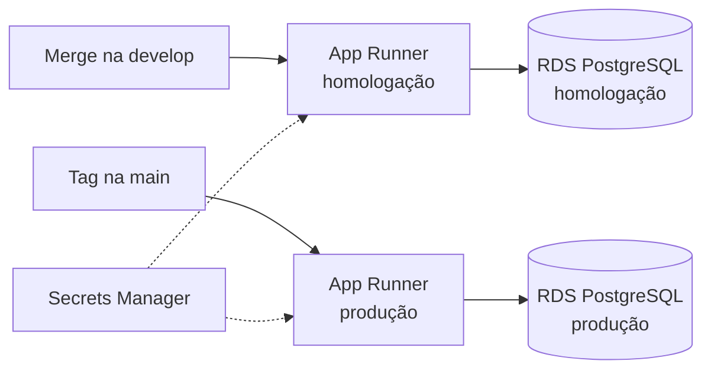

# Meeting Rooms Booker

Sistema interno para reservar salas de reunião.

## Como rodar

Requer Node.js 24+.

```bash
npm install        # instala dependências e gera o Prisma Client
npm run db:setup   # aplica as migrations e popula o banco
npm run dev        # http://localhost:3000
```

## Seed

Seed de usuários:

| Usuário        | Papel |
| -------------- | ----- |
| Daiane Pereira | Comum |
| Bruno Lima     | Comum |
| Yago Santos    | Admin |

Para recriar o banco do zero: `npm run db:reset`.

## Stack

- **Next.js (App Router) + TypeScript strict**: renderização no servidor, server actions e tipagem estrita de ponta a ponta.
- **Prisma + SQLite**: migrations versionadas em SQL legível e seed nativo; SQLite dispensa infraestrutura local.
- **Vitest**: rápido e compatível com TypeScript/ESM sem configuração extra.
- **ESLint (config do Next) + Prettier**: padrão da comunidade, diffs consistentes nos PRs.
- **GitHub Actions**: lint, formatação, typecheck, testes e build em todo PR.

## Decisões

- **Reduzir a duração máxima de uma sala não altera reservas existentes.** O novo limite vale para reservas novas; as futuras que passam dele são mantidas, e o admin vê um aviso com a quantidade ao salvar.

## Testes

```bash
npm test
```

## Produção na AWS

O app roda em contêiner no **AWS App Runner**, em dois ambientes separados: **homologação**, atualizado a cada merge na `develop`, e **produção**, atualizado a cada tag de versão na `main`. Cada ambiente tem seu próprio banco **Amazon RDS for PostgreSQL**, que substitui o SQLite. Senhas e a URL do banco ficam no **AWS Secrets Manager**, separadas por ambiente, e chegam ao app como variáveis de ambiente.


